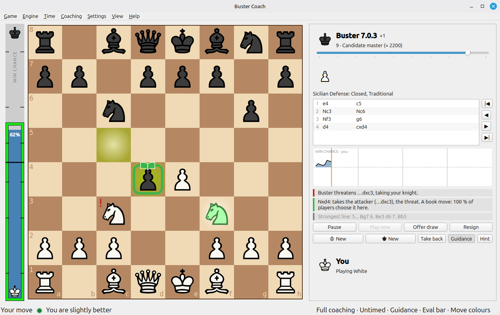

# Buster Coach

**A chess opponent with a coach beside you.** You play a real game against a chess engine, and while you think, a
coach looks at your options with you. It never plays for you: it answers when you ask, and, if you want it to, warns
you when something is wrong.



- **The box.** Pick up a piece, and a box follows the mouse: green for the best move, amber for a playable one, red
  for a mistake. Keep the mouse still for a moment and the coach says *why* — it wins the knight, stops a threat,
  develops a piece, or loses the queen on move 7 — and shows the strongest line. Space plays that line through.
- **Ask, don't be told.** H gives a hint (the piece, then where it goes; hints are counted). T asks what the opponent
  threatens. Your hanging pieces get a red "!".
- **Choose how much help you want:** Tournament (none, and its rules: no takebacks), Play, Guided, or Full coaching.
- **An opponent that plays like a person.** Eleven strengths, from 1 · Beginner (≈ 1000) through 10 · Master
  (≈ 2400) to 11 · Full strength. Each level has a horizon, how far it looks, and makes only the mistakes a player of
  that rating could make: a trap beyond its horizon, never a random blunder. Their frequency is matched to error rates
  from lichess games.
- **After the game:** a win-chance graph with your mistakes marked, the move list with "?" and "!", the coach's
  comments, and your own notes. Every game is saved as PGN, and any PGN file can be opened and played on from any move.
- **Openings:** the name of the opening you're in, a book of what people really play, and opening practice: choose an
  opening, and the opponent plays it while you find your moves.
- **Clocks**, pause, offer a draw, resign; a board editor for setting up positions; light and dark appearance.

Everything is explained in the built-in help (F1), with pictures.

## Download

**The first release is being prepared.** Until then, build it from source (below); on Linux that takes a few minutes.
When it's out, the [Releases](../../releases) page will have:

- **Linux:** `Buster-Coach-<version>-x86_64.AppImage`. Make it executable and start it:
  ```
  chmod +x Buster-Coach-*-x86_64.AppImage
  ./Buster-Coach-*-x86_64.AppImage
  ```
- **Windows:** a zip to unzip anywhere, then start `buster_gui.exe`. A Windows build exists, but it hasn't been tested
  on a real Windows PC yet: under Wine its engines can stop answering in the middle of a game. If you try it on
  Windows, please open an issue and say how it went.

Nothing to install: the chess engine [Buster](https://github.com/andersrcarlsson-stack/Buster-Chess) comes with it,
and plays as both the opponent and the coach.

## What it needs

- **A 64-bit processor from 2013 or later** (x86-64 with BMI2: Intel Haswell, AMD Excavator / Zen, or newer). The
  built-in Buster uses those instructions. On an older processor Buster can't start; the app says so, and you can
  choose another UCI engine in Engine → Engines… (Stockfish, for example).
- **A screen of at least 1366 × 768.**
- Linux: any recent 64-bit distribution (the AppImage carries its own Qt). Windows (not yet tested): 10 or 11, 64-bit.

## Other engines

Any UCI engine can be the opponent or the coach: Engine → Engines…, Add…. The app tests an engine before it uses it.
The strength levels and their ratings are calibrated for the built-in Buster; with another engine the levels still
work, but the ratings aren't shown.

## Feedback

This is the first release. **How do the strength levels feel to you?** Too easy, too hard, a level that plays
strangely? And does the coach ever say something that's wrong or unclear? Please open an issue: a saved game
(Documents/Buster Coach/) and the move you mean help a lot.

## Building from source

Qt 6 (6.4 or newer, Widgets), CMake 3.16+, a C++20 compiler (g++ 11+, or MinGW on Windows).

```
cd app
cmake -B build
cmake --build build -j
ctest --test-dir build          # the six test programs
./build/buster_gui
```

The build is optimised (Release) unless you ask for another type. For the built-in engine, put a Buster binary
named `buster` (`buster.exe` on Windows) next to `buster_gui`, or choose an engine in Engine → Engines….

`tools/` holds the helpers that made the built-in data and the help: the help pages from `app/help/help.md`
(`help_pages.py`), the help's pictures (`helppics/`), and the opening book from the lichess database
(`openingbook/`).

## Licence

Buster Coach is MIT-licensed (see [LICENSE](LICENSE)), © 2026 Anders R Carlsson. It uses Qt (LGPLv3), a chess font
from GNU FreeSerif (GPLv3 with the font exception), and opening data from lichess (CC0); Buster itself is MIT. The
details are in [THIRD-PARTY.md](THIRD-PARTY.md).
