<!-- help.md — the text of Help → How the coach works (release_design.md 5, step 9). Edit here, then run
     python3 tools/help_pages.py to make the HTML pages in app/help/ (built into the app as qrc:/help/...).
     Each "## Title {#page}" starts a page (index = the first page); links between pages: (#page).
     Pictures: , cut from the real board at double size (shown at 60 px a square). -->

## Welcome to Buster Coach {#index}

Buster Coach is a chess opponent with a coach beside you. You play a real game against the opponent (Buster, unless
you choose another engine), and while you think, the coach looks at your options with you. It never plays for you.
It answers when you ask, and, if you want it to, warns you when something is wrong. Just like for the opponent, you
can select another engine to drive the coach.

**To move:** click one of your pieces, then the square it should go to.

**Three things worth knowing from the start:**

- **The box.** When you've picked up a piece, a box follows the mouse over the board: it marks the move you're
  pointing at. At Full coaching the box takes a colour: **green** for the best move, **amber** for a playable one,
  **red** for a mistake.

    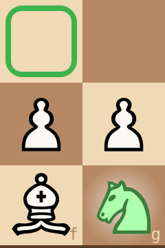  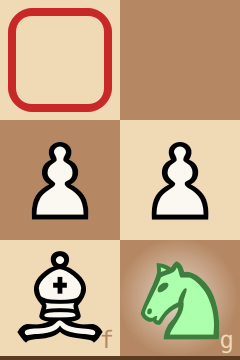
- **Lingering asks a question.** Keep the mouse still on a piece or a move for a moment, and the coach answers in the
  cards under the move list: why the move is good or bad, and what would follow.
- **H gives a hint**, in two steps: first the piece, then where it goes. Hints are counted, so you can see how many
  you needed.

**Choose how much help you want** in the Coaching menu, from **Tournament** (none at all) to **Full coaching**
(everything). And choose your opponent's strength on the slider in its strip, from **1 · Beginner** to
**11 · Full strength**.

More:
- [The signs on the board](#signs) — every colour and mark, and what it means
- [Asking the coach](#asking) — lingering, the cards, the hint, the threat, the play-through
- [The coaching levels](#levels) — Tournament, Play, Guided, Full coaching, and the switches
- [The opponent and its strength](#opponent) — what the levels mean, and how they were made
- [Playing a game](#playing) — clocks, the game buttons, taking back, the end of a game
- [The move list](#movelist) — the marks ? and !, the coach's comments, and your own notes
- [Openings](#openings) — names, the book, and practising an opening
- [Your saved games](#saved) — where they go, and opening them again
- [Keys](#keys) — every shortcut on one page

## The signs on the board {#signs}

Everything the coach shows on the board, by colour. What appears depends on your coaching level.

**Your pieces**: under the mouse, a piece that can move turns **blue** — click it to pick it up, and it turns
**green**. Then the box follows the mouse to show where it can go.

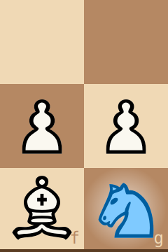 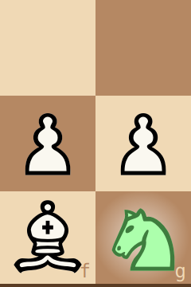

*Left: the mouse on the g1 knight. Right: the knight picked up.*

**The box** — the move you're pointing at, while a piece is picked up.
- **green**: the best move the coach has found (exactly one);
- **amber**: a playable move;
- **red**: a mistake — it loses at least 15 points of winning chance, or two pawns, or it walks into a mate, or it
  misses a forced mate you had;
- **black**: not judged yet (the coach is still thinking), or move colours are off.

   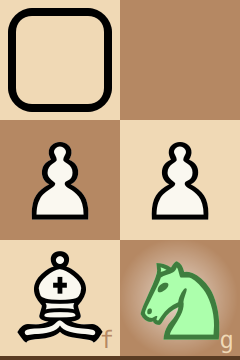

With **colour-blind marks** (Settings) the colours also get ▲ ● ▼ on the box's sides: best, playable, a mistake.

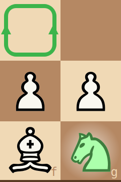 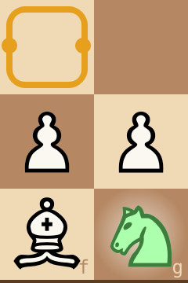 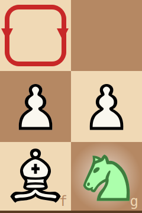

**A small open book** on the box's edge: a book move, one that strong players often choose here. The colour stays the
coach's verdict, so an amber box with a book means "popular, but it costs something". In opening practice, a
**hollow** book marks a book move that leaves the opening you're practising.

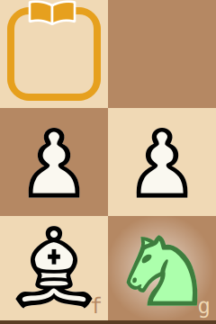 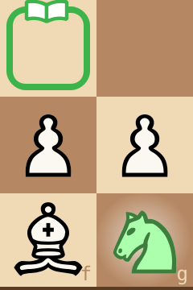

**The last move**: a soft glow on the square a piece arrived on, a paler spot where it came from.
**Check**: a red glow behind the king in check.

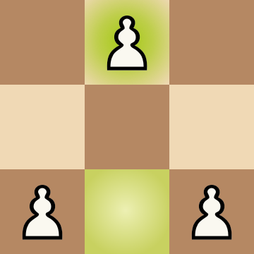 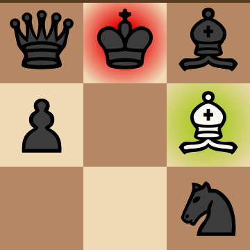

*Left: White has just played e2–e4. Right: the bishop has just taken on f7, and the black king is in check.*

**The hint** (H): magenta — the piece first, then (H again) a magenta box on its target.

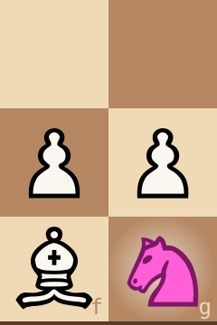 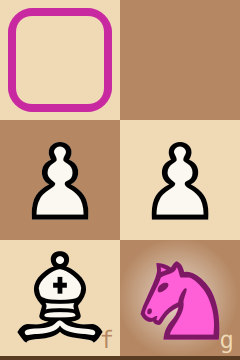

*Left: the first H, the piece to move. Right: the second H, where it goes.*

**A red "!"** in a square's corner: **your** piece there is hanging (attacked and not properly defended). Once the
coach has looked and finds no real threat, the "!" goes: taking the piece wouldn't pay the opponent right now. The
opponent's hanging pieces are never marked; you have to find them, or ask (linger on them).
**The threat** (T): the opponent's piece and the square it would strike, flashed in red.

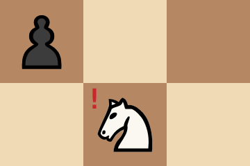 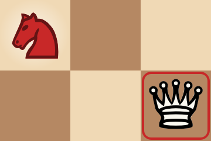

*Left: your knight on e5 is attacked by the d6 pawn and not defended. Right: the threat — the knight would take your
queen.*

**Violet**: you tried a move that isn't legal (only with guidance off).

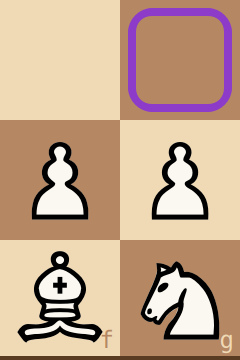

*The knight can't go to g3: the square turns violet.*

**At the end of a game** the mated king turns deep red, or both kings grey for a draw, and a banner across the
board says what happened. Click the board to put it away.

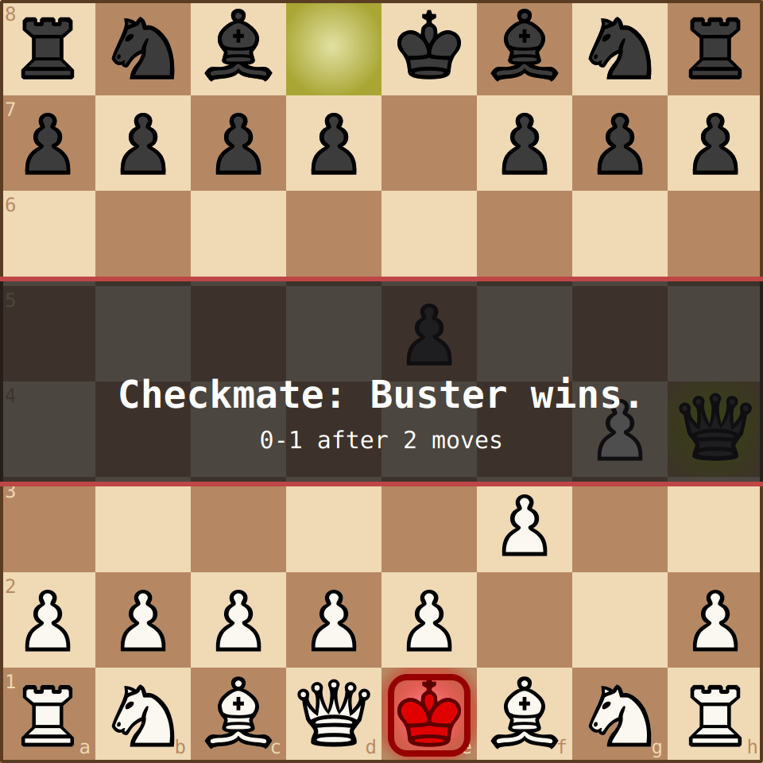

*White is mated: the red king on e1, and the banner with the result and the game's length.*

**The eval bar** (left of the board) is your chance of winning as the coach sees it: blue from the bottom is yours,
grey from the top is the opponent's, and the black line across the middle is equal. The number at the blue's edge is
your chance in percent ("M3": a mate in three). With a piece picked up, a coloured frame shows your chance **if** you
play the move under the box: green means you keep it, red means it drops. At the end of the game it shows WON, LOST
or DRAW.

 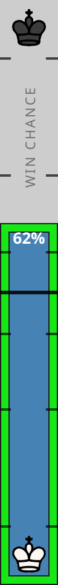 

*Left: a 62 % chance. Middle: a piece picked up, the box on a move that keeps the 62 % (green frame). Right: a move
that would drop it to about 40 % (red frame, down to where your chance would be).*

**The graph** under the move list shows your winning chance after every move of the game: blue above the middle line
(better for you), grey below it. A red dot marks each mistake of yours, and the amber line marks the move the board
is showing. Click a point to see that position.

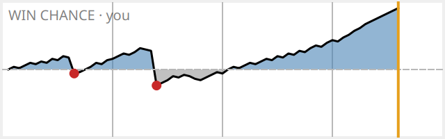

*A game with two mistakes: the first cost a little, the second turned a good position into a worse one, and then
the game turned your way.*

**The coloured dot** in the status bar (bottom left) shows how settled the coach's verdicts are: yellow while they're
still changing, deep green once the coach has looked deeply enough that they no longer change. The box colours are
most reliable at deep green.

 

*Left: still thinking. Right: settled.*

## Asking the coach {#asking}

The coach answers questions you ask by **lingering**: keeping the mouse still on one square for a moment (1.5 s; you
can change that in Settings → Linger time). Keep it there as long again for a second, deeper answer. The pictures on
this page come from two positions: an opening where Black's bishop on g4 pins the f3 knight to the queen, and,
further down the page, the Two Knights Defence, where Black's knight on a5 attacks the bishop on c4.

**On one of your pieces:** a number in its corner tells how many of its moves aren't mistakes. A grey glow means
every move of that piece is a mistake.

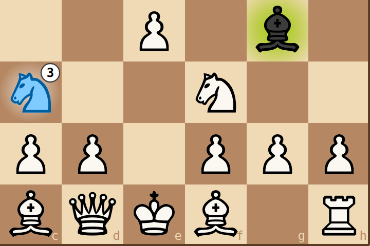 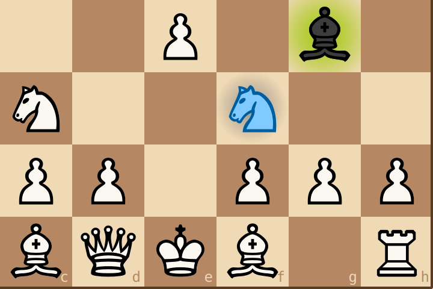

*Left: the c3 knight has 3 moves that aren't mistakes. Right: the f3 knight is pinned — whatever it does, the g4
bishop takes the queen. Every move of it is a mistake, so it glows grey.*

**On a move** (a piece picked up, the box on its target): the coach says **why** — it wins material, gives
material for play (a sacrifice: "gives the bishop for 2 pawns, and wins it back on move 25"), stops a threat or a
mate threat, attacks something, develops a piece, takes the centre. For a mistake: what it loses, or what another
move would do ("another move wins a pawn on move 5" — without naming it: that's what H is for). Linger longer for
**the strongest line**: the moves that would follow.

**On a red move**, the opponent's piece that would punish it, and the square it strikes, flash in red.

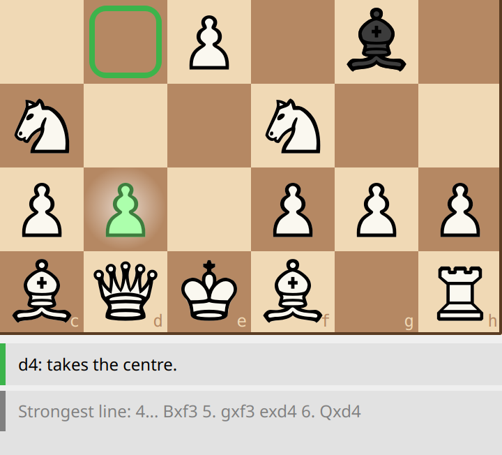 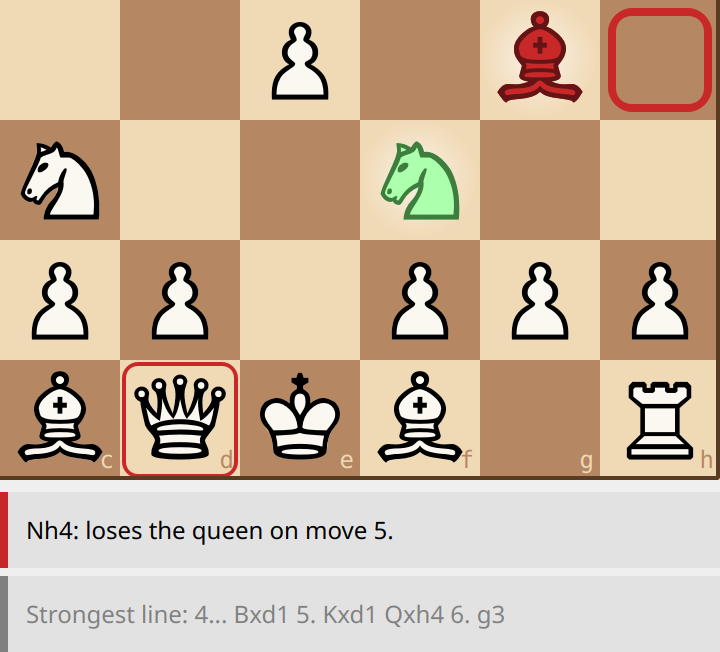

*Left: the box on d4, green: "takes the centre", and the strongest line under it. Right: the knight to h4, red — the
g4 bishop flashes, and so does the queen it would take.*

**On any hanging piece**, yours or the opponent's: the reason in words ("your d5 pawn" when the attacked piece is
the opponent's).

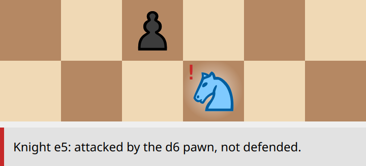

*Lingering on the knight with the red "!": why it's hanging.*

**The cards.** The answers appear as cards under the move list, each with its own coloured edge, always in this
order: on top the threat or the check now (red), then a note about the last move (blue), a hanging piece (red), why
the move is good or bad (its verdict's colour), and the strongest line (grey).

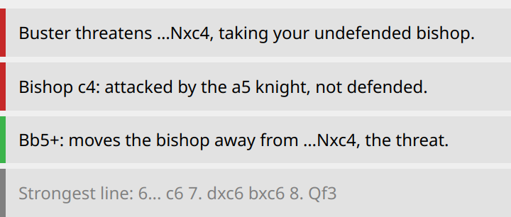

*The Two Knights: the threat, the hanging bishop, why Bb5+ is the best move (it moves the bishop away with check),
and the line that follows.*

**Space — the play-through.** With the box on a move, press Space: the board shows that move, and each further
Space plays one more move of its strongest line, until the line ends. A blue frame round the board says you're
looking at a line, not the game. Esc (or End) brings you back. The real game isn't touched.

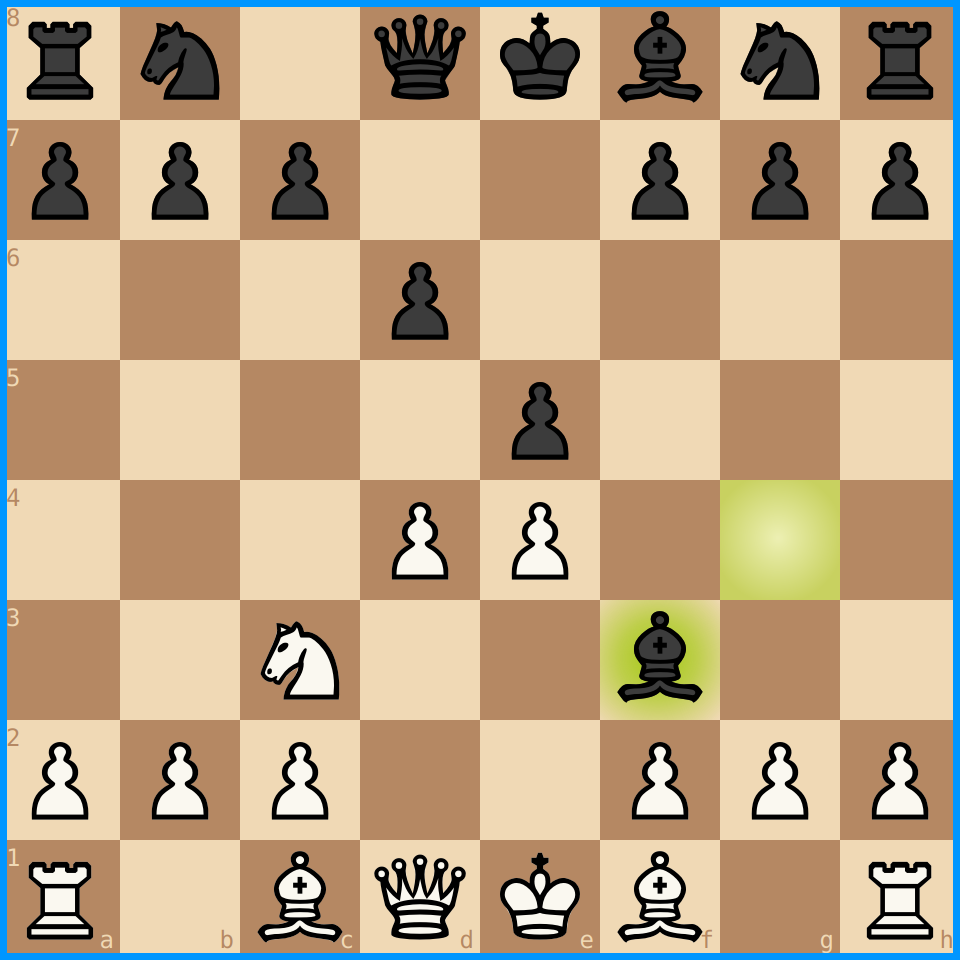

*The box was on d4: Space showed 4. d4, and Space again the reply 4... Bxf3.*

**H — the hint**, in two presses: the piece to move (magenta), then its target. Every press counts. (Pictures:
[The signs on the board](#signs).)

**T — the threat.** What would the opponent do if it could move again right now? T shows it on the board, and the
top card says it in words. If there's no real threat, it says so. Picking up a piece (or Esc) puts the board's
flash away, the words stay; press T again whenever you like. At Full coaching the threat shows by itself when it's
real. In check, the top card says who gives check.

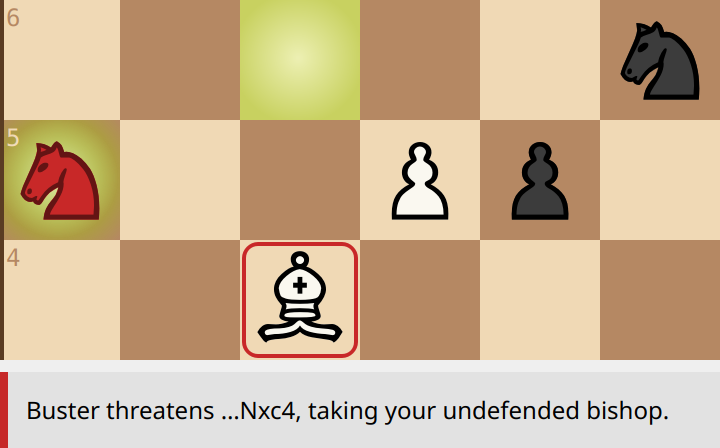

*The a5 knight flashes, and so does the bishop on c4 it would take.*

**Comments after moves.** Sometimes a card tells you something on its own:
- "Buster missed 4... Bxd1. You got away with it." — you made a mistake and the opponent didn't punish it.
- "Buster slipped. There's something here." — the opponent made a mistake. The coach doesn't say what; look for it,
  or press H.

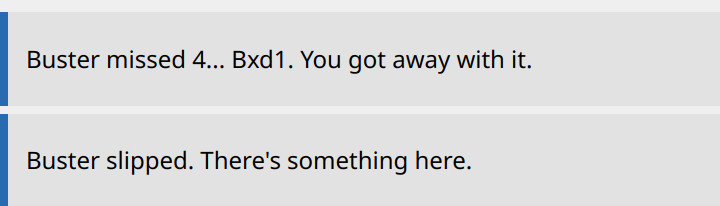

*The blue edge: a note about the move just played. The first: you played the knight to h4, and Buster didn't take
the queen.*

## The coaching levels {#levels}

The Coaching menu has four levels. Each one is a set of switches, and you can change any switch by hand (the level
then becomes **Custom**).

| | Tournament | Play | Guided | Full coaching |
|---|---|---|---|---|
| Guidance: only your movable pieces glow, the box only on legal moves, the last move and check marked | – | – | ✓ | ✓ |
| The eval bar and its words | – | – | ✓ | ✓ |
| Move colours: the box shows the verdict | – | – | – | ✓ |
| Thinking aids: lingering, Space, T | – | – | ✓ | ✓ |
| Hints (H) | – | ✓ | ✓ | ✓ |
| Comments after moves | – | ✓ | ✓ | ✓ |
| Warnings by themselves: the threat, the red "!" | – | – | – | ✓ |

In words: **Tournament** shows nothing. **Play** lets you ask for hints and tells you afterwards. **Guided** adds the
eval bar and everything you can **ask** for. **Full coaching** also colours your moves and **warns you by itself**.

**Tournament** is a real tournament game, with its rules:
- no takeback, not even after the game has ended;
- a clock is required (15 + 10, unless you choose another time control);
- the level, the switches and the opponent's strength are locked until the game ends;
- **touch-move**: once you pick up a piece, you must move it if it can move;
- an **illegal move** costs you: the first gives the opponent an extra minute, the second loses the game;
- no pausing.

## The opponent and its strength {#opponent}

Your opponent is a chess engine: Buster, which comes with the app, or any other UCI engine you choose under Engine →
Engines…. The slider in its strip sets its strength.

**What the levels mean.** Levels 1 to 10 are meant to play like **human players** of rising strength, and level 11
is the engine at full strength.

| Level | Plays roughly like |
|---|---|
| 1 · Beginner | a lichess rapid player of about 1000 |
| 2 · Novice | about 1150 |
| 3 · Casual | about 1300 |
| 4 · Improving | about 1450 |
| 5 · Club player | about 1600 |
| 6 · Strong club | about 1750 |
| 7 · Expert | about 1900 |
| 8 · Strong expert | about 2050 |
| 9 · Candidate master | about 2200 |
| 10 · Master | about 2400 |
| 11 · Full strength | the engine at full strength — far beyond human |

The ratings belong to the built-in Buster: the levels were measured with it. With another engine the levels keep
their order, but not their ratings, so the slider then shows the names only.

Each level is meant to be a clear step up from the one below: if you beat a level about two games out of three, the
next one is about right for you.

**How a level plays.** A real player doesn't lose because they think too little; they lose by **mistakes**: a move
that looked fine to them, punished by something they didn't see. How far a player sees is what their rating is
about. The levels copy that:
- the engine **thinks less** at the lower levels, which gives it the small inaccuracies;
- and each level has a **horizon**: how far ahead it looks when it judges a move. Now and then it plays the move that
  looks best within its horizon instead of the engine's own choice. Usually that's a fine move; but when the position
  hides a trap just beyond the horizon, it walks into it, as a player of that rating would. A beginner may leave a
  piece where it can simply be taken; a 2200 player never does, but can miss a combination three moves deep.
When it errs, the saved game marks the move with "?" and says what it should have played, and at Guided and Full
coaching a card tells you "Buster slipped. There's something here." Spotting and punishing mistakes is a big part of
getting better.

It never blunders in a position that is already decided: a won ending is played out properly.

**How the levels were made.** The ratings are estimates, not promises. We measured how often lichess
players of each rating make mistakes, and how big those mistakes are — about 3000 games for every rating band,
analysed by a strong engine — and tuned each level until its mistakes looked like theirs. We also let the levels play
each other, and Stockfish at known strengths, so that every step is about the same size. What we couldn't do is play
them against real people at those ratings. If a level feels too strong or too weak for your rating, we'd like to hear
about it.

**Full strength** thinks up to a minute on a hard move in an untimed game (about ten seconds on average); "Play now"
makes it move at once. In timed games it uses its clock.

**The opening.** At the start the opponent plays moves from an opening book, as players do: how many moves deep
depends on the level.

## Playing a game {#playing}

- **New game**: the New buttons (♔ as White, ♚ as Black), or Game → New game. During a game, or in a position you set up, 
  they ask for a second click, so nothing is lost by accident.
- **Time** menu: untimed, or a time control (minutes + seconds added per move). A new choice applies from the next game. 
  If your time runs out you lose, unless the opponent couldn't possibly mate with what it has left: then it's a draw. 
  (The same rule applies to the opponent.)
- **Pause** stops the clocks (in a timed game the board is hidden meanwhile). **Play now** makes the opponent move at
  once. **Offer draw**: the opponent accepts if it isn't better. **Resign** ends the game. Draw and Resign ask for a
  second click.
- **Take back** (Ctrl+Z) takes back your last move, and the opponent's answer.
- **Look back** at any earlier move: click it in the [move list](#movelist), or use the arrows beside it (← → Home End). The game
  goes on meanwhile; End or Esc brings you back.
- **Set up a position** (Game → Set up position…) and play from it as White or Black.
- **The end of a game**: a banner across the board, and the eval bar shows WON, LOST or DRAW.

## The move list {#movelist}

The move list shows the game in rows: the move number, White's move, Black's move, and a column for your own notes.
Click a move to see the position after it; the game goes on meanwhile, and End or Esc brings you back. When the game
is over, the last row says how it ended.

**The marks.**
- A move in **red with "?"** was a mistake: it lost at least 15 points of winning chance, or two pawns, or walked into
  a mate, or missed a forced mate. The opponent's mistakes on purpose get one too.
- A move of yours in **green with "!"** was **the only good move**: every other move would have been a mistake, and
  you found it. A simple recapture doesn't count, nor a move made before the coach had looked at every move.

During the game, the marks follow the coaching: yours show with **Comments after moves** (Play, Guided, Full
coaching), the opponent's also need **Guidance** (Guided, Full coaching), and Tournament shows none while you play.
Once the game is over, every mark shows, at every level.

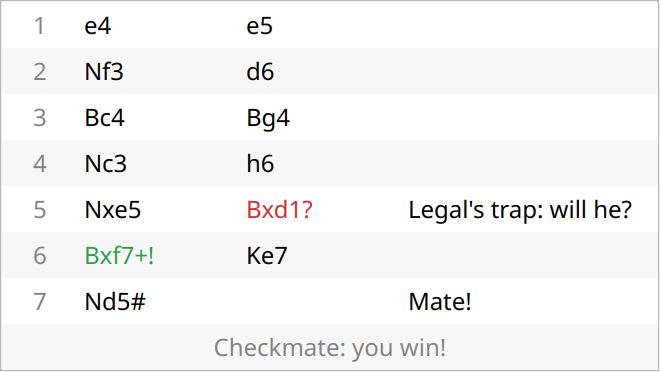

*Legal's mate, with you as White. 5... Bxd1? is Buster's mistake (it allows mate); 6. Bxf7+! was the only move that
wasn't a mistake. Your notes are on the right, and the last row says how the game ended.*

**The coach's comments.** Hover over a move to read what the coach said about it: "Best was Nf3.", "Buster missed
12... Bxf3. You got away with it." They follow the same rule as the marks.

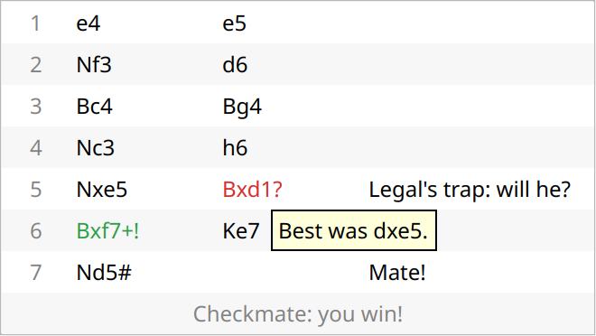

*The mouse on 5... Bxd1?: the move the coach would have played.*

**Your notes.** Double-click the Notes cell of a row and type a note on your move in that row: up to 30 characters.
Enter keeps it, Esc throws it away. Your notes are saved with the game and come back when you open it again.
- In **Tournament** you can write notes once the game is over (the rules allow only the moves during play).
- In an **opened game** you can add notes when it's one of your own saved games; a file from elsewhere shows its
  notes, but isn't changed.

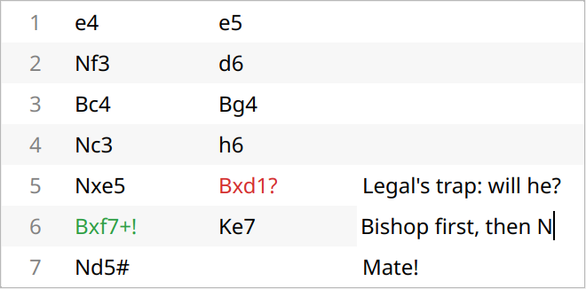

*Typing a note on 6. Bxf7+ during the game.*

## Openings {#openings}

Buster Coach knows about 3,900 named openings and variations, and a book of the moves people really play in them,
counted from a million games on lichess.org. Both are built in; nothing is looked up online.

**The opening's name.** The strip above the move list names the opening you're in, as precisely as the game's moves
allow: "Sicilian Defense", then "Sicilian Defense: Najdorf Variation", then "…, English Attack". Once the game leaves
the named lines, the strip keeps the last name it had — a Najdorf at move 25 is still a Najdorf — and turns grey when
the position is no longer in the book. Hover over the name to see its ECO code (B90: the classic catalogue of
openings). The strip shows with **Guidance** (Guided and Full coaching); the name is saved with the game at every
level.

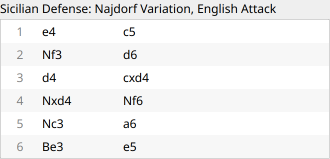

*The strip above the move list, after 6. Be3 e5.*

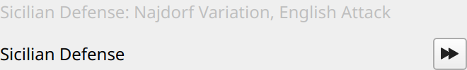

*Top: later in the same game, out of the book: the name stays, in grey. Bottom: in opening practice, ⏩ at the strip's
right end (see below).*

**The opponent plays from the book.** In the opening the opponent often chooses a book move, picked by how often
people play it, so your games don't all start the same way. How long it stays in the book follows its strength: at
level 1 only its first move, from level 7 up to its 7th move. A book move costs it almost no clock time.

**Book moves in the coaching.** With the box on a book move, a small open book sits on the box's edge (Full coaching;
[The signs on the board](#signs)), and the why card adds the book's share: "A book move: 65 % of players choose it
here." The box's colour stays the coach's own verdict: a popular move can still be amber or even red.

**Practise an opening** (Game → Practise an opening…). The side panel shows every named opening as a tree: the
openings, their variations, and the lines inside those. Within each opening the most popular come first, with their
share of all the book's games (a "–": the book never reaches that line; you can still practise it, and the
opponent then plays the named line move by move). Type in the search field to find one, choose
the colour you want to play, and press Start.

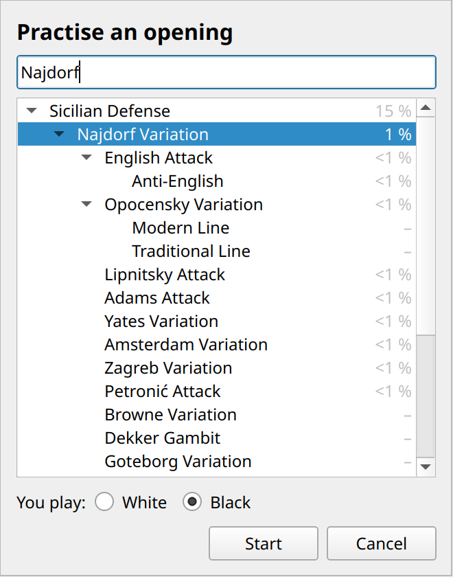

*Searching for the Najdorf, to practise it with Black.*

The game starts from the first move. The opponent plays its moves of the opening at once; where the book knows
several common moves that stay inside your opening, it picks one by how often it's played, so the practice varies.
You try to find your moves. The status bar says "Opening practice" while you're inside.
- **The box's book sign** tells you before you move: **filled** — a book move that stays inside your opening;
  **hollow** — a book move that leaves it. The why card says the same in words, and where the move leads.
- **H** shows the opening's move, not the engine's: the line's next move, or the book's most played move that stays
  inside.
- **⏩** at the strip's right end plays the rest of the line at once, both sides; you go on from there.

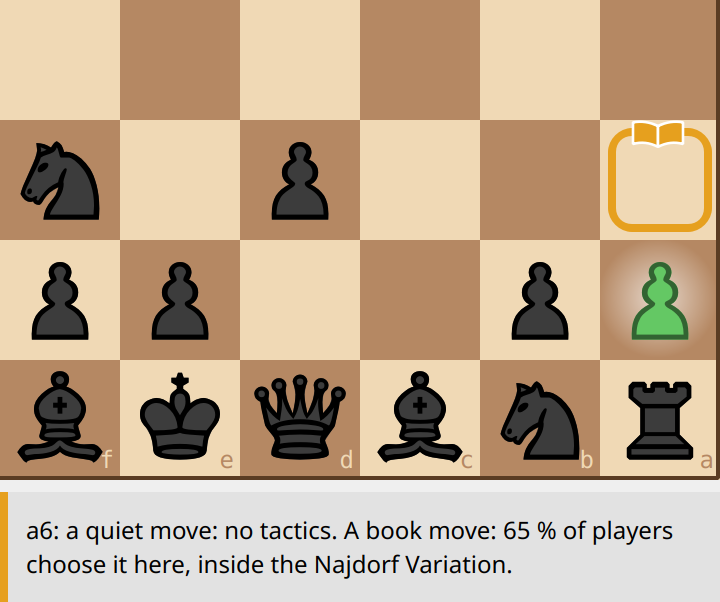 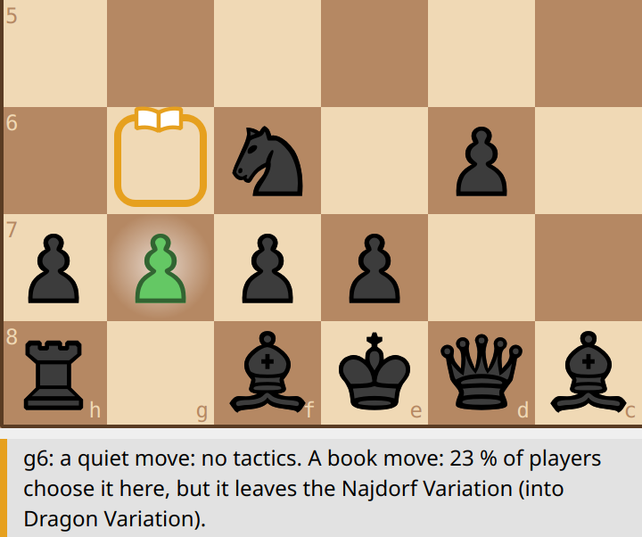

*After 5. Nc3, with Black. Left: 5... a6 — the Najdorf's move, a filled book. Right: 5... g6 is a book move too, but
it leaves the Najdorf for the Dragon: the book is hollow. (Both amber here: the coach's own verdict on each move.)*

If you play a move that leaves the opening, a card says so, with the moves the book plays instead:

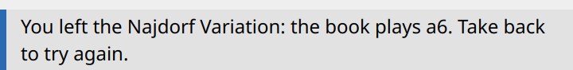

Take back (Ctrl+Z) to try again, or play on: after the opening, practice is a normal game, with all the coaching of
your level.

## Your saved games {#saved}

Every game of 10 moves or more is saved by itself, as a PGN file — the standard chess format that other programs and
websites (lichess, for example) can read — in **Documents/Buster Coach**, one folder per month. Your mistakes are
marked "?" with the better move, your only good moves "!", every move has the coach's evaluation, and your own notes
are kept with their moves. Switch it off under Settings → Save
games automatically; **Forget last game** removes the last one saved.

**Open game…** (Ctrl+O) shows your games, newest first, with the final position. Open one to go through it move by
move with its evaluations and comments; **Play from here** continues it as a new game from the move you're looking
at. Any PGN file can be opened this way.

## Keys {#keys}

| Key | |
|---|---|
| Ctrl+N | new game as White |
| Ctrl+Z | take back |
| Ctrl+O / Ctrl+S | open a game / save the game |
| H | hint |
| T | show the threat |
| Space | play through the move under the box |
| ← → | one move back / forward |
| Home / End | the start / back to the game (Esc too) |
| Ctrl+Q | quit |
